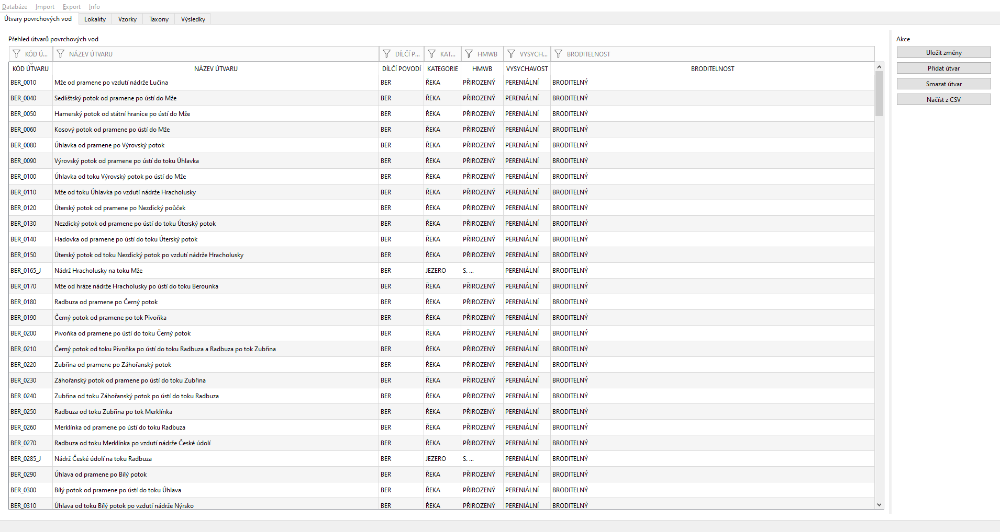
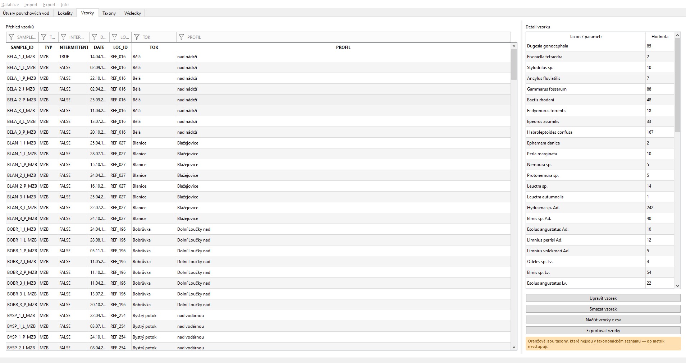
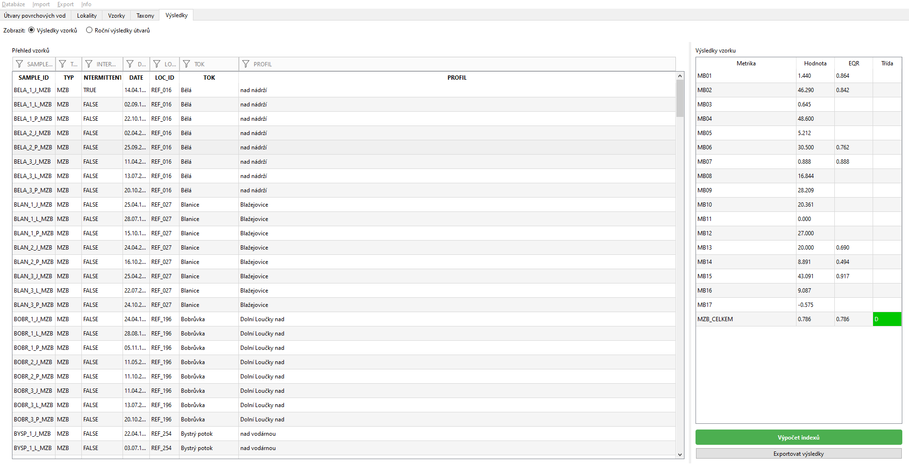

# Uživatelská a technická dokumentace — LULAN

**Limnologický Univerzální Laboratorně Analytický Nástroj**

| | |
|---|---|
| Verze softwaru | 1.0.1 |
| Číslo projektu | SS06010258 |
| Název projektu | Hodnocení ekologického stavu vysychavých toků podle biologických složek |
| Předkládá | Výzkumný ústav vodohospodářský T. G. Masaryka, v. v. i.; Masarykova univerzita |
| Autorský kolektiv | Mgr. Marek Polášek, Ph.D. |

*Tento software byl vytvořen za finanční podpory Technologické agentury ČR
v rámci programu Prostředí pro život.*

---

## Obsah

1. [Identifikace výsledku a jeho účel](#1-identifikace-výsledku-a-jeho-účel)
2. [Uživatelská příručka](#2-uživatelská-příručka)
3. [Technická dokumentace](#3-technická-dokumentace)
4. [Dostupnost a licenční podmínky](#4-dostupnost-a-licenční-podmínky)

---

# 1. Identifikace výsledku a jeho účel

## 1.1 Popis a cíl výsledku

Software umožňuje zadat a vyhodnotit data z biologických vzorků a provést
hodnocení ekologického stavu útvarů povrchových vod podle Rámcové směrnice
o vodách (2000/60/ES). Hodnotí podle aktuálně platných metodik — Marvan
a kol. 2011, Opatřilová a kol. 2011a,b, Kočí a kol. 2011, Němejcová a kol.
2013, Janáč a kol. 2019, Straka a kol. 2026.

Veškeré výpočty se opírají o lokální podkladovou databázi vlastností
a skóre jednotlivých druhů. Tato databáze byla sestavena na základě
výsledků prováděných analýz a je nezbytnou součástí hodnoticích algoritmů.
Software také umožňuje dopočet abiotických parametrů nezbytných pro výpočet
ekologického stavu.

Nástroj byl vytvořen v jazyce Python 3, grafické uživatelské rozhraní je
vystavěno pomocí Qt toolkitu PyQt6.

## 1.2 Odborná novost a přínos

Provést výpočty nutné pro hodnocení ekologického stavu útvarů povrchových
vod podle Rámcové směrnice o vodách v podmínkách ČR dosud neumožňoval žádný
veřejně dostupný nástroj.

## 1.3 Cílová skupina a uplatnění

Nástroj bude sloužit zejména správcům vodních toků, pracovníkům státních
podniků Povodí, Českého hydrometeorologického ústavu a Ministerstva
životního prostředí, kteří odpovídají za hodnocení ekologického stavu
povrchových vod v ČR.

Podkladová databáze byla harmonizována s taxalistem v informačním systému
IS ARROW, a byla tedy optimalizována na taxalist závazný pro determinátory
podniků Povodí. Tím je zajištěno snadné nasazení standardně sbíraných dat
na výpočetní nástroj a začlenění hodnoticího procesu do stávajícího systému
hodnocení.

---

# 2. Uživatelská příručka

## 2.1 Hardwarové a softwarové požadavky

Program je samostatná desktopová aplikace. Nevyžaduje připojení k internetu
ani žádný server — jedinou výjimkou je dopočet abiotických parametrů, který
se dotazuje veřejných služeb ČÚZK (viz kapitola 2.3.6).

**Operační systém**

| Systém | Požadavek |
|---|---|
| Windows | 10 nebo 11, 64bitové |
| macOS | 11 Big Sur nebo novější; Intel i Apple Silicon |
| Linux | Debian 12 / Ubuntu 22.04 nebo novější, 64bitové |

**Hardware**

| Položka | Minimum | Doporučeno |
|---|---|---|
| Procesor | 64bitový, 2 jádra | 4 jádra |
| Operační paměť | 4 GB | 8 GB |
| Místo na disku | 250 MB | 500 MB |
| Rozlišení obrazovky | 1280 × 800 | 1920 × 1080 |

Paměťové nároky určuje velikost databáze, ne program sám. Při běžné práci
s několika stovkami vzorků si aplikace vystačí s 300 MB paměti; databáze
s desítkami tisíc taxonomických záznamů může nároky zvýšit.

Program nevyžaduje předem nainstalovaný Python ani Qt — instalační balíčky
obsahují vlastní běhové prostředí. Instalace nepotřebuje práva správce
kromě samotného zápisu do systémových adresářů.

## 2.2 Instalační návod a spuštění

### 2.2.1 Windows

Spusťte instalátor `LULAN-setup-1.0.1.exe` a projděte průvodce. Program se
nainstaluje do `C:\Program Files\LULAN`, zástupce se vytvoří v nabídce Start
a volitelně na ploše.

Protože program není podepsaný certifikátem pro podpis kódu, zobrazí
Windows při prvním spuštění modré okno **SmartScreen** („Systém Windows
ochránil váš počítač"). Spuštění se povolí odkazem **Další informace →
Přesto spustit**. Podrobnosti a možnosti řešení popisuje soubor
`PODPIS.md`.

### 2.2.2 macOS

Otevřete obraz `LULAN-1.0.1.dmg` a aplikaci přetáhněte do složky Aplikace.

Při prvním spuštění macOS oznámí, že aplikaci nelze otevřít, protože nelze
ověřit vývojáře. Povolí se takto:

1. V dialogu klikněte na **Hotovo**.
2. Otevřete **Nastavení systému → Soukromí a zabezpečení**.
3. V části **Zabezpečení** klikněte u LULANu na **Přesto otevřít**.
4. Potvrďte heslem nebo Touch ID.

Stačí jednou.

Nepovede-li se to, bývá na vině značka karantény, kterou macOS dává
souborům staženým z internetu. Sejme se z Terminálu:

```bash
xattr -dr com.apple.quarantine /Applications/LULAN.app
```

Přepínač `-r` je podstatný — aplikace je adresář se stovkami souborů
a značku může nést kterýkoli z nich. Odpoví-li příkaz
`No such xattr: com.apple.quarantine`, značka tam není a příčina je
jinde; podrobnosti řeší `PODPIS.md`.

### 2.2.3 Linux (Debian, Ubuntu)

```bash
sudo apt install ./lulan_1.0.1_amd64.deb
```

Program se nainstaluje do `/opt/lulan`, spouštěč `lulan` do `/usr/bin`
a položka do nabídky aplikací. Odinstaluje se příkazem
`sudo apt remove lulan`.

### 2.2.4 Umístění databáze

Program se dodává s ukázkovou databází. Protože do programových adresářů
běžný uživatel zapisovat nesmí, **přenese si ji při prvním spuštění do svých
dat**:

| Systém | Umístění |
|---|---|
| Windows | `%LOCALAPPDATA%\LULAN\LULAN_dtb_001.db` |
| macOS | `~/Library/Application Support/LULAN/LULAN_dtb_001.db` |
| Linux | `~/.local/share/LULAN/LULAN_dtb_001.db` |

Odinstalace programu tuto kopii nesmaže, o vložená data tedy nepřijdete.
Titulek okna vždy ukazuje, se kterým souborem se právě pracuje.

Jinou databázi lze otevřít nabídkou **Databáze → Otevřít…** (Ctrl+O).
Nenajde-li se databáze při startu, program nabídne výběr souboru místo toho,
aby se ukončil.

> **Databázi neukládejte do složky synchronizované do cloudu** (ownCloud,
> OneDrive, Dropbox) ani na síťový disk. SQLite si na takovém úložišti
> neporadí se zamykáním souborů; projevuje se to chybami „disk I/O error"
> nebo „database is locked" a v horším případě poškozením databáze. Program
> takové umístění sám rozpozná, upozorní na ně a nabídne práci z místní
> kopie, kterou při ukončení uloží zpět.

## 2.3 Návod k obsluze a funkce

Hodnoticí nástroj pracuje nad lokální databází (SQLite), která uchovává
veškerá používaná data a umožňuje operace nad nimi. Pro fungování nástroje
tedy není třeba připojení k externí databázi přes internet a nástroj je
zcela autonomní. Grafické rozhraní v jednoduchých tabelárních přehledech
umožňuje prohlížení dat v databázi, případně jejich editaci. Import i export
dat probíhá pomocí souborů CSV.



*Obr. 1: Grafické rozhraní hodnoticího nástroje — záložka Útvary povrchových
vod. Nad tabulkou je řádek filtrovacích polí, vpravo ovládací prvky.*

V hodnoticím nástroji lze přepínat mezi pěti úrovněmi hierarchie dat:

**Útvary povrchových vod → Lokality → Vzorky → Taxony → Výsledky**

Každá záložka je rozdělena na přehledovou tabulku vlevo a detail vybraného
záznamu vpravo. Nad každou tabulkou je řádek filtrovacích polí označených
piktogramem trychtýře; zápis do pole omezí zobrazené řádky na ty, které
zadaný text obsahují. Filtry se dají kombinovat napříč sloupci.

### 2.3.1 Útvary povrchových vod

Přehled vodních útvarů a jejich vlastností, které rozhodují o použité
metodice hodnocení:

| Sloupec | Význam |
|---|---|
| `KATEGORIE` | R = tekoucí voda (řeka), J = stojatá voda (jezero) |
| `HMWB` | P = přirozený, S = silně ovlivněný, U = umělý |
| `VYSYCHAVY` | P = stálý tok (perenální), I = vysychavý |
| `BROD` | B = broditelný, NEBROD = nebroditelný |

Kódované hodnoty se zobrazují jako čitelné popisky („ŘEKA", „PŘIROZENÝ").
Mění se dvojklikem na buňku, který otevře dialog s přepínači — do číselníku
tak nelze zapsat hodnotu, které by výpočet nerozuměl.

### 2.3.2 Lokality

Odběrné profily s abiotickými parametry. Detail vpravo obsahuje souřadnice
v několika systémech (WGS84, S-JTSK, S-42, UTM) a parametry potřebné pro
výpočet: Strahlerův řád, nadmořskou výšku, plochu povodí, vzdálenost od
pramene, podélný sklon a úmoří. U stojatých vod navíc hloubky, plochu
hladiny, dobu zdržení a geologii.

Pod detailem je mapový náhled s obrysem ČR a hlavními toky, který ukazuje
polohu vybrané lokality. Slouží ke kontrole, že souřadnice nejsou zjevně
chybné.

### 2.3.3 Vzorky

Seznam odběrů. Detail vpravo ukazuje taxonomické složení vzorku — jeden
řádek na taxon s jeho abundancí. **Taxony, které nejsou v taxonomickém
seznamu dané složky, jsou podbarvené oranžově**; výpočet je přeskočí,
takže je dobré si jich všimnout.

Obsah vzorku se upravuje tlačítkem **Upravit vzorek**, které otevře
samostatné okno pro přidávání, změnu a mazání taxonů.



*Obr. 2: Záložka Vzorky. V levé části tabelární přehled všech vzorků
v databázi, v pravé části taxonomické složení vybraného vzorku a abundance
bezobratlých.*

### 2.3.4 Taxony

Taxonomické seznamy s autekologickými charakteristikami. Přepínačem nad
tabulkou se volí složka (MZB, FB, RYBY, MF). Detail vpravo vypisuje
vlastnosti taxonu; zkratky jsou přeložené do češtiny podle číselníku
`dtb/ciselnik_traits.csv`, samotná zkratka zůstává v závorce, aby ji šlo
dohledat v metodice.

Ve sloupci `SYN` se u synonym ukazuje platné jméno, ne jen příznak.

### 2.3.5 Výsledky

Vypočtené hodnoty. Přepínačem lze volit mezi výsledky pro jednotlivé vzorky
a ročními agregovanými výsledky pro vodní útvar.

Detail vzorku vypisuje jeden řádek na metriku: název metriky, naměřenou
hodnotu, její EQR a u celkového hodnocení také třídu. Názvy metrik se
překládají podle číselníku `dtb/hodnoceni_zkratky.csv` — místo `MB01` se
zobrazí *Saprobní index (MB01)*. Třída celkového hodnocení je barevně
odlišená.

Tlačítkem **Vypočítat indexy** se spustí výpočet pro všechny vzorky
v databázi. Nástroj v závislosti na typu vzorku a typu nadřazeného vodního
útvaru zvolí odpovídající metodiku, vypočte hodnoty metrik a multimetrik
a zapíše je do databáze. Existující výsledky se přepíšou. Agregace na útvar
a rok proběhne automaticky.



*Obr. 3: Záložka Výsledky. Lze přepínat mezi výsledky pro vzorky a ročními
agregovanými výsledky pro vodní útvar. Vpravo detail hodnocení včetně
jednotlivých metrik, jejich EQR a celkového multimetrického indexu.*

### 2.3.6 Dopočet abiotických parametrů

Tlačítko v záložce Lokality doplní chybějící abiotické parametry ze
souřadnic WGS84. Odvozují se z veřejných geografických podkladů (DIBAVOD,
rozvodnice ČHMÚ, ZABAGED, DMR) — říční síť je součástí instalace, nadmořská
výška a sklon se dotahují ze služby ČÚZK, k čemuž je potřeba připojení
k internetu.

Před spuštěním se zobrazí dialog se zdroji dat a jejich licencemi.

> Dopočet je **pomocná funkce**. Hodnoty jsou odvozené automaticky a nejsou
> zaručeně správné — před použitím pro hodnocení je zkontrolujte. Podrobnosti
> o ověřené přesnosti jsou v kapitole 3.5.

### 2.3.7 Import dat

Data se importují z CSV nabídkou **Import**. Podporované tabulky:

| Položka nabídky | Cílová tabulka | Klíč záznamu |
|---|---|---|
| Lokality (odběrné profily) | `loc` | `KOD` |
| Vodní útvary | `utvary` | `ID_UTVARU` |
| Vzorky a jejich data | `samples` + `data` | `SAMPLE` + `TYP` + `LOC_ID` + `DATE` |

**Postup**

1. **Stáhněte si vzorový soubor** — nabídka *Import → Stáhnout vzorový
   soubor*. Soubor obsahuje hlavičku, komentářové řádky s popisem každého
   sloupce (co znamená, zda je povinný, jaké hodnoty jsou povolené)
   a jeden ukázkový řádek. Komentáře začínají `#` a import je ignoruje,
   takže soubor lze nahrát i s nimi.
2. **Vyplňte data.** Oddělovač může být středník, tabulátor nebo čárka —
   program ho rozpozná sám, stejně jako kódování (UTF-8, Windows-1250,
   ISO-8859-2). Datum se přijímá ve tvaru `15.04.2024` i `2024-04-15`,
   desetinná čárka i tečka.
3. **Spusťte import** — nabídka *Import → Importovat: …*
4. **Zkontrolujte přehled.** Program soubor nejprve celý ověří a teprve
   pak se zeptá. Neprojde-li kontrola, import se vůbec nespustí a vypíše
   se seznam chyb s čísly řádků.
5. **Rozhodněte o existujících záznamech** — přepsat hodnotami ze souboru,
   nebo ponechat původní a nové přeskočit.

**Formát dat vzorků.** Jeden řádek = jeden taxon v jednom vzorku. Kód
vzorku se tedy opakuje tolikrát, kolik má vzorek taxonů. Před importem
proto program místo seznamu řádků ukáže přehled po vzorcích:

```
Chystáte se importovat 5 vzorků:
   REF_027_III_P_MZB (MZB, 24.10.2015) — 90 taxonů
   REF_055_III_P_MZB (MZB, 20.10.2015) — 44 taxonů
   ...
```

Řádky se stejným kódem vzorku, názvem taxonu, typem, lokalitou a datem se
slučují — u biologických složek součtem abundancí, u chemie (`TYP = CHEM`)
průměrem. Pokryvnost makrofyt se průměruje, protože jde o podíl plochy,
ne o počet.

Lokalita, která v databázi ještě není, se založí prázdná; abiotické
parametry k ní lze doplnit později (kapitola 2.3.6).

Vzorky stojatých vod mají navíc sloupce `BIOMASA`, `POKRYVNOST`, `SIT`
(bentická/pelagická tenatní síť) a `ZONA` (hrázová/přítoková část). U ryb
ve stojatých vodách tvoří síť a zóna součást klíče — týž druh ulovený
bentickou a pelagickou sítí jsou dva samostatné záznamy, protože metriky
CZ-FBI je rozlišují.

**Starší exporty.** Sloupec `HMCH` se automaticky převede na dnešní `HMWB`.

### 2.3.8 Export dat

Nabídka **Export** nabízí čtyři sestavy do CSV (oddělovač `;`, kódování
UTF-8 s BOM, takže se soubor správně otevře i v českém Excelu):

| Sestava | Obsah |
|---|---|
| Vzorky | seznam vzorků s lokalitami |
| Data vzorků | taxonomické složení, jeden řádek na taxon |
| Výsledky — souhrn | celkové hodnocení každé složky po vzorcích |
| Výsledky — metriky | všechny metriky v dlouhém formátu |
| Výsledky — roční | agregace na vodní útvar a rok |

## 2.4 Řešení chybových stavů

| Hlášení | Příčina | Řešení |
|---|---|---|
| *Nelze se připojit k databázi* | soubor chybí, je poškozený nebo k němu nejsou práva | program nabídne výběr jiného souboru; zkuste zálohu |
| *Soubor … nevypadá jako databáze LULANu* | vybraný soubor je sice SQLite, ale nemá tabulky programu | vyberte správný soubor |
| *database is locked* / *disk I/O error* | databáze leží na síťovém disku nebo v synchronizované složce | přesuňte ji na místní disk, nebo přijměte nabídku práce z místní kopie |
| *Import se nezdařil* | chyba zápisu do databáze | zavřete ostatní programy, které k databázi přistupují, a zkuste znovu |
| *V souboru chybí povinné sloupce* | nesedí hlavička CSV | porovnejte se vzorovým souborem z nabídky Import |
| *řádek N: sloupec X: '…' není číslo* | chybná hodnota v CSV | opravte řádek; import se nespustil a v databázi se nic nezměnilo |
| Oranžově podbarvený taxon | název není v taxonomickém seznamu složky | opravte název podle taxalistu, nebo taxon do seznamu doplňte — jinak ho výpočet přeskočí |
| Ve výsledcích chybí metrika | vzorek nemá potřebná data nebo lokalita nemá abiotické parametry | důvod je ve sloupci `POZN` u řádku výsledku |
| Prázdný sloupec třídy u dílčí metriky | to není chyba | třída se uvádí jen u celkového hodnocení složky |

**Vzorek se nevyhodnotil vůbec.** Nejčastější příčiny, v tomto pořadí:
lokalita nemá přiřazený vodní útvar (sloupec `VU`); útvar není v tabulce
`utvary`; útvar je označen jako umělý (`HMWB = U`), kde se biologické složky
podle metodiky nehodnotí; vzorek nemá žádná taxonomická data. Důvod se vždy
zapíše do poznámky u výsledku.

**Hlášení o prostředí.** Nabídka *Info → Kontrola prostředí* vypíše verze
Qt a Pythonu, grafickou platformu a stav ovládacích prvků. Tyto údaje
přiložte k hlášení chyby.

---

# 3. Technická dokumentace

## 3.1 Systémová architektura

Aplikace je jednovrstvá desktopová aplikace bez serverové části. Tvoří ji
čtyři vrstvy:

```
┌──────────────────────────────────────────────────────┐
│  Grafické rozhraní (PyQt6)                           │
│  main_app_deploy.py — pět záložek, menu, dialogy     │
│  editor_vzorku, radek_filtru, mapa_lokalit,          │
│  sirky_sloupcu, ciselniky, ciselnik_*                │
├──────────────────────────────────────────────────────┤
│  Výpočetní jádro (calc_index/)                       │
│  registry → výběr metodiky, runner → orchestrace,    │
│  moduly jednotlivých složek a typů útvarů            │
├──────────────────────────────────────────────────────┤
│  Vstup a výstup                                      │
│  import_csv, export_csv, abiotic_params, ricni_sit   │
├──────────────────────────────────────────────────────┤
│  Databáze SQLite (dtb/LULAN_dtb_001.db)              │
│  přes QSqlDatabase (GUI) i sqlite3 (import, dopočet) │
└──────────────────────────────────────────────────────┘
```

**Oddělení výpočtu od rozhraní.** Balík `calc_index` nezná grafické prvky
a dostává jen spojení do databáze a kód vzorku. Díky tomu jdou výpočty
spustit i z příkazové řádky a nástroje v `_tools/` toho využívají pro
srovnávání s referenčními daty (kapitola 3.5).

**Přístup k databázi.** GUI čte a zapisuje spojením Qt (`QSqlDatabase`),
import CSV a dopočet abiotických parametrů používají modul `sqlite3`, aby
šly spustit i mimo aplikaci. SQLite nepustí k zápisu druhé spojení, dokud
nad souborem někdo drží rozečtený dotaz — a modely Qt načítají řádky po
dávkách, takže dotaz nikdy samy nedočtou. Zápisy jiným spojením proto
probíhají uvnitř bloku, který nejdřív donutí modely dotaz dočíst a tím
zámek uvolnit.

**Cesty k datům.** Umístění dat řeší jediný modul `cesty.py`. Rozlišuje běh
ze zdrojových kódů a běh ze zabalené aplikace, kde PyInstaller ukládá data
do podadresáře `_internal`.

## 3.2 Použité algoritmy a teoretický základ

### 3.2.1 Postup hodnocení

Hodnocení každého vzorku probíhá v pěti krocích:

1. **Určení metodiky** podle složky vzorku a vlastností nadřazeného vodního
   útvaru (`registry.py`).
2. **Načtení dat vzorku** a taxonomického seznamu složky; vyřešení synonym
   a taxonomických úprav.
3. **Výpočet metrik** — dílčích ukazatelů, každý podle vzorce své metodiky.
4. **Převod na EQR** (Ecological Quality Ratio) — každá metrika se lineárně
   převede na škálu 0–1 podle referenční a nejhorší hodnoty pro daný typ
   toku. U metrik, kde vyšší hodnota znamená horší stav (saprobní index),
   se škála obrací.
5. **Multimetrika a klasifikace** — EQR dílčích metrik se sloučí (podle
   metodiky prostým nebo váženým průměrem, případně odmocninou) a výsledek
   se zařadí do třídy.

Třídy ekologického stavu odpovídají Rámcové směrnici: velmi dobrý, dobrý,
střední, poškozený, zničený. U silně ovlivněných a umělých útvarů se hodnotí
ekologický **potenciál** s vlastními hranicemi tříd.

### 3.2.2 Výběr metodiky

Rozhodování je vedeno jako tabulka v `registry.py` — klíčem je pětice
(složka, kategorie útvaru, HMWB, vysychavost, broditelnost), hodnotou
hodnoticí funkce. Zástupný znak `*` znamená, že na dané vlastnosti nezáleží;
klíče se vyhodnocují od nejkonkrétnějšího k nejobecnějšímu, takže výjimka
se přidá jako konkrétnější řádek. Tabulková podoba byla zvolena proto, že
kombinací je přes dvacet a vnořené podmínky by se staly nepřehlednými.

| Složka | Typ útvaru | Modul | Metodika |
|---|---|---|---|
| MZB | tok, stálý, broditelný | `mzb_perennial_broditelne` | Opatřilová a kol. 2011b |
| MZB | tok, stálý, nebroditelný | `mzb_perennial_nebroditelne` / `mzb_velke_reky` | Němejcová a kol. 2013 |
| MZB | tok, vysychavý | `mzb_intermittent` | Straka a kol. 2026 |
| MZB | tok, silně ovlivněný, broditelný | `mzb_potencial_broditelne` | Opatřilová a kol. 2013 |
| FB | tok, stálý | `fb_perennial` | Marvan a kol. 2011 |
| FB | tok, vysychavý | `fb_intermittent` | Straka a kol. 2026 |
| FP | tok | `fp_reka` | Opatřilová a kol. 2011a |
| FP | jezero | `jezera_fp` (CZ-PHYPI) | metodika pro kategorii jezero |
| MF | tok | `mf_reka` | Kočí a kol. 2011 |
| MF | jezero | `jezera_mf` (CZ-MPHYI) | metodika pro kategorii jezero |
| RYBY | tok | `ryby_reka` (CZI) | Janáč a kol. 2019 |
| RYBY | tok, silně ovlivněný / umělý | `ryby_potencial` | Janáč a kol. 2024 |
| RYBY | jezero | `jezera_ryby` (CZ-FBI) | metodika pro kategorii jezero |

Zvláštní pravidla zabudovaná do registru:

* U **umělých útvarů** (`HMWB = U`) se biologické složky nehodnotí vůbec;
  hodnocení se provádí jen podle fyzikálně-chemických parametrů.
* U **fytobentosu a makrofyt** se silně ovlivněné útvary hodnotí shodně
  s přirozenými — metodika pro ně nemá vlastní hranice tříd.
* U **makrozoobentosu** má hodnocení potenciálu vlastní převodní tabulku
  se sníženými horními mezemi.
* **Velké nebroditelné řeky** jsou vymezeny jmenným seznamem útvarů
  (`velke_reky_utvary.py`), ne jen příznakem `BROD` — odchytí se dřív, než
  se dojde k tabulce registru.
* Vysychavost se bere z útvaru i z příznaku vzorku (`INTERMITTENT`);
  příznak vzorku má přednost.

### 3.2.3 Typologie

Některé metodiky vyžadují zařazení do typu toku nebo jezera, protože podle
něj se liší referenční hodnoty:

* **Ryby** — typy A až G podle nadmořské výšky, plochy povodí a Strahlerova
  řádu (`ryby_typologie.py`).
* **Jezera** — kód sestavený z nadmořské výšky, průměrné hloubky, doby
  zdržení a geologie (`jezera_typologie.py`).
* **Silně ovlivněné útvary pro ryby** — kategorie I až X podle jmenného
  seznamu (`ryby_hmwb_utvary.py`).

### 3.2.4 Dopočet abiotických parametrů

Pomocná funkce, která ze souřadnic WGS84 odvodí parametry potřebné pro
hodnocení. Postup: souřadnice se převedou do S-JTSK, najde se nejbližší
úsek říční sítě, z jeho atributů se přečte Strahlerův řád a vzdálenost od
pramene, z rozvodnic plocha povodí a úmoří, z digitálního modelu reliéfu
nadmořská výška a podélný sklon.

Říční síť je předpočítaná do samostatné databáze `dtb/ricni_sit.db`
(generátor `_tools/gen_ricni_sit.py`), aby aplikace nepotřebovala geopandas
ani shapely — ty by k instalaci přidaly přes 200 MB.

## 3.3 Struktura zdrojového kódu a modulů

```
LULAN/
├── src/                        zdrojový kód aplikace
│   ├── main_app_deploy.py      hlavní okno, pět záložek, menu
│   ├── cesty.py                umístění dat (zdrojáky vs. zabalená app)
│   ├── uloziste.py             detekce síťového a synchronizovaného úložiště
│   ├── import_csv.py           import CSV včetně popisu tabulek
│   ├── export_csv.py           export dat a výsledků
│   ├── editor_vzorku.py        okno pro úpravu obsahu vzorku
│   ├── radek_filtru.py         řádek filtrů lícující se sloupci
│   ├── sirky_sloupcu.py        srovnání šířek podle plochy tabulky
│   ├── mapa_lokalit.py         mapový náhled (čte shapefile přímo)
│   ├── ciselniky.py            kódované sloupce → čitelné popisky
│   ├── ciselnik_traits.py      překlad zkratek autekologie
│   ├── ciselnik_metrik.py      překlad zkratek metrik
│   ├── csv_ciselnik.py         čtení číselníků včetně detekce kódování
│   ├── o_aplikaci.py           texty dialogu O aplikaci
│   ├── abiotic_params.py       dopočet abiotických parametrů
│   ├── ricni_sit.py            práce s odvozenou říční sítí
│   ├── B_index2.py             predikční model B-indexu
│   ├── calc_indexes.py         veřejné rozhraní výpočtu (tenká fasáda)
│   ├── calc_index/             výpočetní jádro (viz níže)
│   └── GIS/                    vrstvy pro mapový náhled
├── dtb/                        databáze a číselníky
├── img/                        ikony
├── build/                      předpisy pro sestavení instalátorů
├── _tools/                     vývojové nástroje, generátory, kontroly
├── metodiky/                   PDF metodik
└── kontrola_vysledku/          kontrolní sešity pro validaci
```

Balík `calc_index/` má tři vrstvy:

| Vrstva | Moduly | Úloha |
|---|---|---|
| Rozhodování | `registry`, `velke_reky_utvary`, `ryby_hmwb_utvary`, `jezera_utvary` | podle vlastností útvaru vybrat metodiku |
| Orchestrace | `runner`, `jezera_runner` | projít vzorky, zapsat výsledky, agregovat na útvar a rok |
| Výpočet | `mzb_*`, `fb_*`, `fp_*`, `mf_*`, `ryby_*`, `jezera_*` | metriky a multimetriky jedné kombinace |
| Podpora | `common`, `jezera_common`, `*_table`, `neimplementovane` | sdílené funkce, převodní tabulky EQR |

Převodní tabulky EQR jsou v samostatných modulech (`*_table.py`) záměrně —
jde o rozsáhlá data z příloh metodik, která by jinak zastínila kód výpočtu.

## 3.4 Datový model

Databáze SQLite. Hlavní tabulky a jejich vazby:

```
utvary ──< loc ──< samples ──< data
                      │
                      ├──< results ──> results_year (agregace)
                      ├──< adjust_table
                      └──< predict_taxa

taxalist_MZB / _FB / _MF / _RYBY   (nezávislé číselníky)
```

### Provozní tabulky

| Tabulka | Klíč | Obsah |
|---|---|---|
| `utvary` | `ID_UTVARU` | vodní útvary a vlastnosti rozhodující o metodice |
| `loc` | `KOD` | odběrné profily, souřadnice, abiotické parametry |
| `samples` | `SAMPLE_ID` | hlavičky vzorků: složka, datum, lokalita, příznak vysychavosti |
| `data` | `sample` + `name` | taxonomické složení: abundance, biomasa, pokryvnost, síť, zóna |
| `results` | `SAMPLE_ID` + `METRIC` | vypočtené metriky: hodnota, EQR, třída, poznámka |
| `results_year` | `UTVAR_POV` + `ROK` | roční agregace po složkách |
| `adjust_table` | `sample` + `name` | abundance po taxonomických úpravách |
| `predict_taxa` | `sample_id` | predikce taxocenóz pro B-index |

### Referenční tabulky

| Tabulka | Obsah |
|---|---|
| `taxalist_MZB`, `_FB`, `_MF`, `_RYBY` | taxonomické seznamy s autekologickými charakteristikami |
| `taxalist_*_zaloha` | zálohy taxalistů pro kontrolu změn hodnot |
| `adjustace` | pravidla taxonomických úprav (sloučení, přejmenování) |
| `B_index_taxa_prob` | pravděpodobnosti výskytu taxonů pro B-index |
| `taxalist_chem`, `chem_params` | chemické parametry a jejich popis |

Taxonomické seznamy nesou desítky až stovky sloupců s autekologickými
charakteristikami — saprobní valence, preference proudu a substrátu,
teplotní preference, způsob rozmnožování, indikátory vysychání. Jejich
zkratky překládá číselník `dtb/ciselnik_traits.csv`.

### Rozhraní

Aplikace nemá API. Výměna dat probíhá soubory CSV (kapitoly 2.3.7 a 2.3.8),
jejichž struktura je popsána v modulu `import_csv.py` a promítá se do
vzorových souborů, které si uživatel stáhne z nabídky Import. Přidání další
importovatelné tabulky tedy nevyžaduje zásah do grafického rozhraní.

## 3.5 Testování a validace

Validace probíhala dvěma způsoby: srovnáním s výstupy informačního systému
IS ARROW a srovnáním s kalibračními daty, na kterých byly metodiky
sestaveny. Srovnávací nástroje jsou v adresáři `_tools/` a generují HTML
reporty s korelačními grafy a statistikami odchylek po jednotlivých
metrikách. Podrobný záznam všech nalezených rozdílů a jejich příčin je
v souboru `OPRAVY.md`.

### 3.5.1 Fytobentos — srovnání s IS ARROW

Podklad: 409 vzorků z exportu IS ARROW.

| Veličina | Shoda |
|---|---|
| FB01 — saprobní index | 409 / 409 |
| EQR | 409 / 409 |
| Součet indikačních vah | 409 / 409 |
| FB03 — střední chyba | 409 / 409 |

Výchozí stav byl 343 / 409. Rozdíl způsobilo osm taxonů, u nichž se hodnoty
v `taxalist_FB` rozcházely se zálohou, a zaokrouhlený index vstupující do
výpočtu EQR. Po sjednocení taxalistu a opravě zaokrouhlení je shoda úplná.

### 3.5.2 Makrofyta — srovnání s IS ARROW

Podklad: 33 vzorků z broditelných toků.

| Veličina | Korelace | Shodných |
|---|---|---|
| Index MTV | 0,998 | 20 / 32 |
| EQR | 0,998 | 20 / 32 |
| Počet indikátorových taxonů | 0,981 | 24 / 33 |
| Typ toku | — | **33 / 33** |
| Třída ekologického stavu | — | **32 / 33** |

Typ toku i výsledná třída souhlasí prakticky bez výjimky; rozdíly v MTV jsou
v řádu zaokrouhlení a na zařazení do třídy se neprojeví.

### 3.5.3 Makrozoobentos — ověření převodu metodiky

Původní výpočet byl vestavěn do rozsáhlého větvení podmínek. Při převodu do
tabulkové podoby bylo ověřeno:

* všech **28 kombinací** (typ lokality × sezóna × Strahlerův řád) bylo
  z původního kódu vytaženo a numericky ověřeno proti němu (50 náhodných
  hodnot na metriku),
* rozřazovací tabulka dává pro všech **20 kombinací** složka × kategorie ×
  vysychavost × broditelnost shodný výsledek s původním rozhodováním,
* regresní běh na **157 reálných vzorcích** vykázal rozdíly odpovídající
  výhradně opraveným chybám, nikoli převodu samotnému.

### 3.5.4 Vysychavé toky — makrozoobentos

Podklad: kalibrační data metodiky Straka a kol. (2026) — 101 lokalit,
458 vzorků, matice 1 049 taxonů. Hodnotí se 222 jarních vzorků, u nichž je
vyplněné referenční EQR; podzimní sběr metodika nepoužívá.

| Metrika | Korelace | Shodných |
|---|---|---|
| MI01 — podíl pošvatek | **1,000** | 201 / 222 |
| MI02 — Margalefův index | **1,000** | **222 / 222** |
| MI03 — saprobní valence | 0,987 | 0 / 222 |
| MI04 — teplotní preference | 0,948 | 1 / 222 |
| MI05 — způsob rozmnožování | 0,854 | 15 / 222 |

Metriky MI01 a MI02 souhlasí přesně. U MI03–MI05 zůstává systematický
posun, který byl dohledán k rozdílům v hodnotách autekologických
charakteristik mezi kalibrační tabulkou a taxalistem v databázi — nikoli
k vzorcům. Vysoká korelace při nízkém počtu přesných shod je pro takový
posun typická.

### 3.5.5 Vysychavé toky — fytobentos

Podklad: kontrolní data metodiky — 85 lokalit, 228 vzorků, matice 681
taxonů, hodnoceno 120 jarních vzorků.

| Metrika | Korelace | Medián \|Δ\| |
|---|---|---|
| FI01 — saprobní index | 0,709 | 0,467 |
| FI02 — salinita | 0,877 | 0,089 |
| FI03 — nároky na kyslík | 0,911 | 0,128 |
| **Multimetrika (FB_CELKEM)** | **0,970** | **0,028** |

Před opravou vycházela korelace multimetriky **−0,53** — výpočet šel proti
smyslu, protože se EQR dvou metrik neobracelo. Po opravě je 0,970.
Zbytkový rozdíl u FI01 má známou příčinu: referenční sloupec `sap`
v kontrolním sešitu je jiná veličina než saprobní index počítaný z MSZS.

### 3.5.6 Ryby

Modul byl ověřen na příkladech uvedených přímo v metodice a následně
spuštěn na kompletní sadě vzorků v databázi.

### 3.5.7 Dopočet abiotických parametrů

Dopočet abiotických parametrů je pomocná funkce. Hodnoty jsou odvozené
automaticky z veřejných geografických vrstev a nejsou zaručeně správné.

Přesnost byla ověřena na 86 lokalitách proti hodnotám z IS ARROW:

| Parametr | Shoda |
|---|---|
| Úmoří | 86 / 86 přesně |
| Strahlerův řád | 85 / 86 přesně |
| Vzdálenost od pramene | medián odchylky 6 m |
| Plocha povodí | medián odchylky 0,9 % |

Na jednotlivé lokalitě ale může být odchylka podstatně větší — zejména
u drobných toků, u toků pramenících v zahraničí a tam, kde souřadnice míří
mimo osu toku.

---

# 4. Dostupnost a licenční podmínky

## 4.1 Licence programu

```
MIT License

Copyright (c) 2026 Masarykova univerzita

Permission is hereby granted, free of charge, to any person obtaining a copy
of this software and associated documentation files (the "Software"), to deal
in the Software without restriction, including without limitation the rights
to use, copy, modify, merge, publish, distribute, sublicense, and/or sell
copies of the Software, and to permit persons to whom the Software is
furnished to do so, subject to the following conditions:

The above copyright notice and this permission notice shall be included in
all copies or substantial portions of the Software.

THE SOFTWARE IS PROVIDED "AS IS", WITHOUT WARRANTY OF ANY KIND, EXPRESS OR
IMPLIED, INCLUDING BUT NOT LIMITED TO THE WARRANTIES OF MERCHANTABILITY,
FITNESS FOR A PARTICULAR PURPOSE AND NONINFRINGEMENT. IN NO EVENT SHALL THE
AUTHORS OR COPYRIGHT HOLDERS BE LIABLE FOR ANY CLAIM, DAMAGES OR OTHER
LIABILITY, WHETHER IN AN ACTION OF CONTRACT, TORT OR OTHERWISE, ARISING
FROM, OUT OF OR IN CONNECTION WITH THE SOFTWARE OR THE USE OR OTHER DEALINGS
IN THE SOFTWARE.
```

## 4.2 Data a jejich licence

Pod licencí MIT je **zdrojový kód** aplikace. Data, se kterými aplikace
pracuje, se řídí licencemi svých správců a licence MIT se na ně nevztahuje.

Týká se to zejména odvozené říční sítě (`ricni_sit.db`) a podkladových GIS
vrstev — jde o odvozená díla z DIBAVOD, ZABAGED a rozvodnic ČHMÚ. Rovněž
metodiky hodnocení, taxonomické seznamy a autekologické charakteristiky jsou
autorskými díly třetích stran.

| Vrstva | Správce | Licence |
|---|---|---|
| **DIBAVOD** — Digitální báze vodohospodářských dat<br>říční síť, názvy a identifikátory toků, Strahlerův řád, vzdálenost od pramene, vrstva hlavních toků v mapovém náhledu<br><https://www.dibavod.cz> | Výzkumný ústav vodohospodářský T. G. Masaryka, v. v. i. | © VÚV TGM, v. v. i. |
| **Rozvodnice základních ploch povodí 4. řádu**<br>plocha povodí, číslo hydrologického pořadí, úmoří<br><https://data.gov.cz> | Český hydrometeorologický ústav | CC BY 4.0 |
| **ZABAGED®** — Základní báze geografických dat ČR<br>podklad, ze kterého jsou DIBAVOD i rozvodnice odvozeny<br><https://geoportal.cuzk.gov.cz> | Český úřad zeměměřický a katastrální | CC BY 4.0 — „ČÚZK, 2026" |
| **DMR 5G / DMR 4G** — digitální model reliéfu ČR<br>nadmořská výška, podélný sklon toku<br><https://geoportal.cuzk.gov.cz> | Český úřad zeměměřický a katastrální | CC BY 4.0 — „ČÚZK, 2026" |

**Citace DIBAVOD:** FOJTÍK, T., JAŠÍKOVÁ, L., KURFIŘTOVÁ, J., MAKOVCOVÁ, M.,
MAŤAŠOVSKÁ, V., MAYER, P., NOVÁKOVÁ, H., ZAVŘELOVÁ, J. a ZBOŘIL, A. *GIS
a kartografie ve VÚV TGM.* Vodohospodářské technicko-ekonomické informace,
2022, roč. 64, č. 1, str. 47–52. ISSN 0322-8916.

## 4.3 Použité metodiky

Janáč M., Jurajda P., Polášek M., Němejcová D. (2019): *Metodika hodnocení
ekologického stavu útvarů povrchových vod tekoucích (kategorie řeka) pomocí
biologické složky ryby.* Aktualizace metodického postupu Horký a Slavík
(2011). Zpracováno pro MŽP.

Kočí M., Grulich V., Opatřilová L., Horký P. (2011): *Metodika hodnocení
ekologického stavu útvarů povrchových vod tekoucích pomocí biologické složky
makrofyta.* VÚV TGM, v. v. i., Certifikovaná metodika MŽP. Aktualizace
platná od března 2018.

Marvan P., Opatřilová L., Heteša J., Maciak M., Horký P. (2011): *Metodika
hodnocení ekologického stavu útvarů povrchových vod tekoucích (kategorie
řeka) pomocí biologické složky fytobentos.* VÚV TGM, v. v. i., Certifikovaná
metodika MŽP. Aktualizace platná od března 2018.

Němejcová D., Zahrádková S., Opatřilová L., Syrovátka V. (2013): *Metodika
hodnocení biologické složky bentičtí bezobratlí pro velké nebroditelné
řeky.* VÚV TGM, v. v. i., Certifikovaná metodika MŽP. Aktualizace platná od
března 2018.

Opatřilová L., Desortová B., Potužák J., Liška M., Maciak M., Horký P.
(2011a): *Metodika hodnocení ekologického stavu útvarů povrchových vod
tekoucích pomocí biologické složky fytoplankton.* VÚV TGM, v. v. i.,
Certifikovaná metodika MŽP. Aktualizace platná od března 2018.

Opatřilová L., Kokeš J., Němejcová D., Syrovátka V., Zahrádková S.,
Maciak M., Horký P. (2011b): *Metodika hodnocení ekologického stavu útvarů
povrchových vod tekoucích (kategorie řeka) pomocí biologické složky
makrozoobentos.* VÚV TGM, v. v. i., Certifikovaná metodika MŽP. Aktualizace
platná od března 2018.

Straka M., Výravský D., Polášek M., Němejcová D. (2026): *Metodika hodnocení
ekologického stavu vysychavých toků pomocí biologických složek.* VÚV TGM,
v. v. i., Certifikovaná metodika MŽP.

---

## Související dokumenty v repozitáři

| Soubor | Obsah |
|---|---|
| `PODPIS.md` | podpis programu a varování systémů při instalaci |
| `UKLID.md` | které soubory jsou pro běh potřeba a které ne |
| `GIS_PROTOTYP.md` | odvození abiotických parametrů z GIS vrstev |
| `OPRAVY.md` | záznam oprav a ověření jednotlivých metodik |
| `REVIZE_KODU.md` | poznámky z revize zdrojového kódu |
